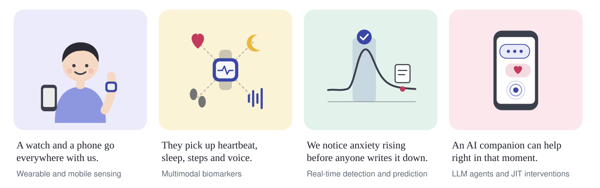

I measure anxiety, panic and depression from wearables and phones, without asking people to report them.

### Publications

- **Panic Attack Prediction for Patients With Panic Disorder via Machine Learning and Wearable Electrocardiography Monitoring.** H. Oh, …, H. Hwang, …, H. Piao. *JMIR*, 2025
- **전술 경보 의사결정 안정성에 대한 다중 관측 에이전트 기반 점수 통합 분석.** S. Lee, H. Hwang, C. Hwang, A. Kim. *JKIICE*, 2026

### Find me

[Google Scholar](https://scholar.google.com/citations?user=tHFnujcAAAAJ) · [ORCID](https://orcid.org/0009-0008-5020-6687) · hhr8779@gmail.com
